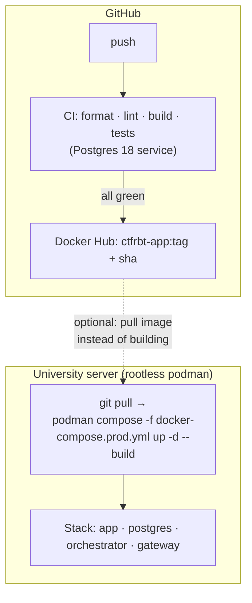
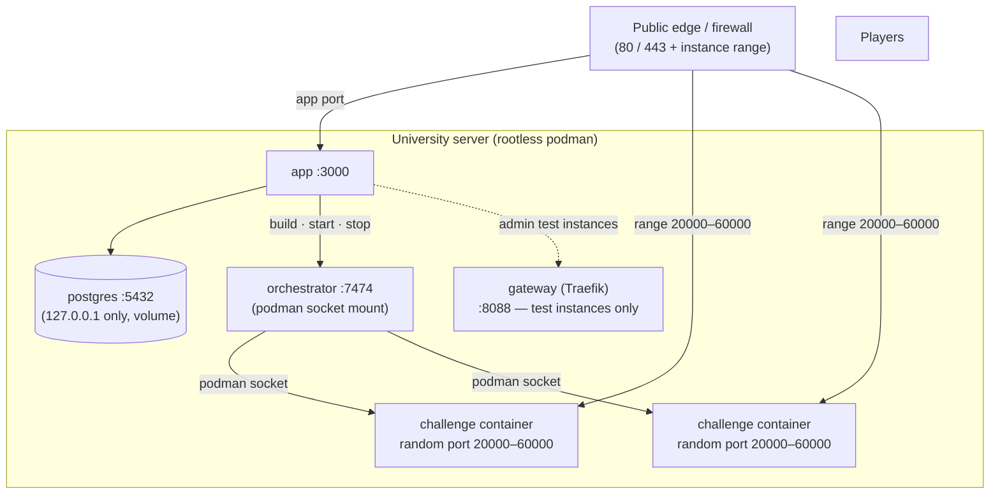
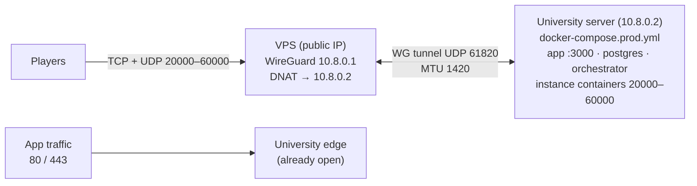

# Deployment guide

How CTFrbt is built, shipped and run — from the source tree to a live CTF
host, plus the post-deploy steps that make the box effective for an event.

## Deployment (podman compose)

One server, rootless podman, one compose file:
[`docker-compose.prod.yml`](../docker-compose.prod.yml). The stack is
**app**, **postgres** (published on `127.0.0.1` only), the
**orchestrator** (part of the stack; it mounts the rootless podman socket)
and the **gateway** (Traefik, for admin test instances). Secrets come from
`.env` next to the compose file — never committed.

CI gates every push (format · lint · build · tests) and also publishes
`<user>/ctfrbt-app:<tag>` images to Docker Hub (`dev`/`latest`/`main` plus
a short-SHA tag). The registry image is optional — you can use it for
rollbacks or to skip building on the server — but the deploy itself is
always the same command:

```bash
cd /path/to/CTFrbt
podman compose -f docker-compose.prod.yml up -d --build
```



## Server layout



Challenge containers are created **outside** the stack by the
orchestrator, which talks to the host's podman socket — see
`DOCKER_SOCKET_PATH` below.

## Podman user services (rootless)

The stack runs under the user's podman; its user services must survive a
reboot without a login session:

```bash
systemctl --user enable --now podman.socket
sudo loginctl enable-linger ctf   # keep user services up across reboots
```

- The socket lives at `/run/user/<uid>/podman/podman.sock` — that is the
  `DOCKER_SOCKET_PATH` the orchestrator uses.
- Quadlet units in `~/.config/containers/systemd/` (if any) also start at
  boot thanks to the linger.

## Environment variables

Everything the app needs (see `.env.example` and `.env.prod`):

| Variable                                                             | Notes                                                                                                    |
| -------------------------------------------------------------------- | -------------------------------------------------------------------------------------------------------- |
| `POSTGRES_PASSWORD`                                                  | database password (generated secret) — the compose builds `DATABASE_URL` from it                         |
| `APP_PORT`                                                           | host port for the app (default 3000)                                                                     |
| `NEXTAUTH_SECRET` / `NEXTAUTH_URL`                                   | secret + the public origin players use                                                                   |
| `ORCHESTRATOR_SECRET`                                                | shared app ↔ orchestrator secret                                                                         |
| `DOCKER_SOCKET_PATH`                                                 | `/run/user/<uid>/podman/podman.sock` on the rootless podman host                                         |
| `GATEWAY_HOST`                                                       | **the host players reach** — LAN IP in dev, VPS/public IP in prod (with the 20000–60000 range forwarded) |
| `SESSION_MAX_AGE_HOURS`                                              | set to at least the event duration                                                                       |
| `RATE_LIMIT_IP_MAX` / `RATE_LIMIT_AUTH_MAX` / `LOGIN_LOCKOUT_IP_MAX` | raise for venues where many players share one public IP (campus NAT, carrier CGNAT)                      |
| `NEXT_PUBLIC_RECAPTCHA_SITE_KEY` / `RECAPTCHA_SECRET_KEY`            | per-env keys, baked in at build time                                                                     |

## Post-deploy checklist

1. **Migrations** run automatically on container start
   (`prisma migrate deploy` in the app CMD) — nothing to do.
2. **Seed** (idempotent; run from a machine that has the source, never from
   the container — the runner image ships no `src/`):

   ```bash
   DATABASE_URL="postgresql://<user>:<pass>@<db-host>:5432/<db>" pnpm db:seed
   ```

   Creates `admin/admin123` plus the dev teams — change the admin password
   before the event.

3. **Edge forwarding**: open the app port **and** the **20000–60000** range
   on the public edge toward the VM. Players' instances are unreachable
   without the range.
4. **Game window**: set start/end in **Admin → Game Configuration**.
   Players cannot start instances after the CTF has ended (the sweep keeps
   the host clean).
5. **Dynamic challenges**: author per
   [dynamic-challenges.md](./dynamic-challenges.md), then verify with
   _Start test instance_.
6. **Smoke test**: register a test team, start an instance, connect
   `http://<GATEWAY_HOST>:<port>`, submit its flag.

## Operating the host during an event

- **Fleet tab** (admin): live table of every instance (state, address,
  expiry, restarts) with a kill button — use it to free resources.
- **Sweeper**: expired instances are stopped and deleted automatically
  (throttled sweep piggybacked on reads); no cron needed.
- **Rate limiting** is in-memory per app instance — fine for a single
  replica; the stack runs one.
- **Rollback**: rebuild from the previous commit
  (`git checkout <short-sha> && podman compose -f docker-compose.prod.yml
up -d --build`), or re-deploy the matching Docker Hub short-SHA image.

## VPS relay (WireGuard tunnel) — exposing the instance range

Use this when the venue's firewall only opens **80/443** to the VM and
will not forward the instance range. A small public VPS (a 1 GB RAM /
20 GB disk Oracle free-tier instance is plenty — it only relays traffic,
it never runs containers) fronts the **20000–60000** range and tunnels
**TCP and UDP** to the university server, where the whole stack runs
with [`docker-compose.prod.yml`](../docker-compose.prod.yml) on rootless
podman.



- The instance ports are random per start (20000–60000); the DNAT covers
  the whole range, so nothing changes when an instance re-rolls its port.
- The app itself stays behind the university's already-open 80/443 — the
  VPS only fronts the instance range.
- SSH challenges keep working: there is no HTTP proxy in the path.
- The venue firewall stops mattering for instances: traffic **leaves**
  the VM over the tunnel (egress, rarely blocked) and **enters** the VPS,
  which you control.

### 1. WireGuard on the VPS

```bash
apt update && apt install -y wireguard
```

Generate the key pairs (one pair per server), then swap the public keys
between the two machines:

```bash
# On the VPS
wg genkey | tee vps-private.key | wg pubkey > vps-public.key

# On the university server
wg genkey | tee server-private.key | wg pubkey > server-public.key

# Exchange: scp server-public.key <VPS>:/etc/wireguard/
#           scp vps-public.key   <server>:/etc/wireguard/
```

```bash
# /etc/wireguard/wg0.conf
[Interface]
Address = 10.8.0.1/24
ListenPort = 61820
PrivateKey = <contents of vps-private.key>
PostUp = sysctl -w net.ipv4.ip_forward=1
MTU = 1420

[Peer]  # the university server
PublicKey = <contents of server-public.key>
AllowedIPs = 10.8.0.2/32
```

```bash
wg-quick up wg0
systemctl enable --now wg-quick@wg0
```

### 2. WireGuard on the university server

```bash
apt install -y wireguard   # (or dnf install wireguard-tools)

# /etc/wireguard/wg0.conf
[Interface]
Address = 10.8.0.2/24
PrivateKey = <contents of server-private.key>
MTU = 1420

[Peer]
PublicKey = <contents of vps-public.key>
AllowedIPs = 10.8.0.1/32
Endpoint = <VPS-PUBLIC-IP>:61820
PersistentKeepalive = 25
```

```bash
wg-quick up wg0
systemctl enable --now wg-quick@wg0
wg show   # peer handshake must be recent
```

### 3. VPS firewall: security list + DNAT

Oracle **security list** (or the VPS firewall) inbound rules:

| Rule        | Source                           | Protocol |
| ----------- | -------------------------------- | -------- |
| 20000–60000 | `0.0.0.0/0`                      | TCP      |
| 20000–60000 | `0.0.0.0/0`                      | UDP      |
| 61820       | venue egress IP (or `0.0.0.0/0`) | UDP      |

> WireGuard uses **61820** (not the conventional 51820) on purpose: the
> tunnel port sits outside the participant instance range 20000–60000, so
> it never collides with a published instance port.

DNAT + forward on the VPS, step by step (the public NIC is `ens3` on
Oracle — adapt the name if yours differs):

1. **Back up** the current rules:

   ```bash
   sudo iptables-save | sudo tee ~/iptables-backup-$(date +%F).rules
   ```

2. **Remove any catch-all REJECT in the FORWARD chain.** If a
   `-j REJECT --reject-with icmp-host-prohibited` rule heads the chain,
   it shadows the ACCEPTs below and external clients see
   "No route to host" even with a healthy tunnel:

   ```bash
   sudo iptables -L FORWARD -n -v   # look for a leading -j REJECT
   sudo iptables -D FORWARD -j REJECT --reject-with icmp-host-prohibited
   ```

3. **Enable and persist IP forwarding** (the `wg0` `PostUp` already sets
   it at runtime):

   ```bash
   sudo sysctl -w net.ipv4.ip_forward=1
   echo 'net.ipv4.ip_forward=1' | sudo tee /etc/sysctl.d/99-ctfrbt-wg.conf
   ```

4. **Add the DNAT / FORWARD / MASQUERADE rules**:

   ```bash
   sudo iptables -t nat -A PREROUTING -p tcp --dport 20000:60000 -j DNAT --to-destination 10.8.0.2
   sudo iptables -t nat -A PREROUTING -p udp --dport 20000:60000 -j DNAT --to-destination 10.8.0.2
   sudo iptables -A FORWARD -i ens3 -o wg0 -j ACCEPT
   sudo iptables -A FORWARD -i wg0 -o ens3 -m state --state ESTABLISHED,RELATED -j ACCEPT
   sudo iptables -t nat -A POSTROUTING -o wg0 -j MASQUERADE
   ```

5. **Persist**:

   ```bash
   sudo apt install -y iptables-persistent
   sudo netfilter-persistent save
   ```

6. **Verify** the rules are in place and the counters climb on an
   external connection:

   ```bash
   sudo iptables -t nat -L PREROUTING -n -v
   sudo iptables -L FORWARD -n -v
   ```

`MASQUERADE` makes the routing symmetric (replies always come back
through the tunnel), but every player then appears to the app as the
tunnel IP `10.8.0.1` — the app's per-IP rate limiting and login lockout
collapse into one bucket. If you need real client IPs (recommended for a
competitive event), replace the MASQUERADE with **policy routing on the
server** instead:

```bash
# University server: send tunnel-arrived flows back through the tunnel
iptables -t mangle -A PREROUTING -i wg0 -j CONNMARK --set-mark 1
iptables -t mangle -A OUTPUT -m connmark --mark 1 -j CONNMARK --restore-mark
echo "100 wgroute" >> /etc/iproute2/rt_tables
ip rule add fwmark 1 table 100
ip route add default via 10.8.0.1 dev wg0 table 100
```

Test the variant you keep **before the event** from a machine outside
the venue network.

### 4. University server: run the stack

Rootless podman user services must be on (see "Podman user services"):

```bash
systemctl --user enable --now podman.socket
sudo loginctl enable-linger ctf

cd /path/to/CTFrbt
podman compose -f docker-compose.prod.yml up -d --build
```

App env (`.env.prod`):

```env
NEXTAUTH_URL=http://<university-public-url>   # the 80/443 edge
GATEWAY_HOST=<VPS-PUBLIC-IP>                  # where players reach instances
```

### 5. Verify before the event

1. `wg show` on both ends — recent handshake on each peer, and
   `ping 10.8.0.2` from the VPS (and vice versa).
2. Admin → **Start test instance** → the card shows
   `http://<VPS-IP>:<port>`; connect from a machine **outside** the
   venue network: `curl http://<VPS-IP>:<port>` (TCP), and a UDP client
   if the challenge uses UDP. Testing `10.8.0.2:<port>` from the VPS
   only proves the tunnel — the DNAT path is exercised by the external
   connection.
3. Watch the **Fleet** tab: instances should show `RUNNING` with the VPS
   address.

### Risks

- **Venue egress**: the server must be able to send UDP 61820 out. If
  the venue blocks it, fall back to **Tailscale** (DERP relays ride on
  outbound 443).
- **VPS egress quota**: free tiers cap monthly egress (~200 GB) — ample
  for a multi-hour event.
- **MTU**: keep `MTU = 1420` on both WireGuard ends or large packets
  stall inside the tunnel.
- **Tunnel is a single point of failure**: both `wg-quick` units are
  boot-enabled; monitor the link during the event.
- **Latency**: pick the VPS region closest to the venue.
