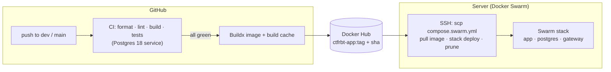
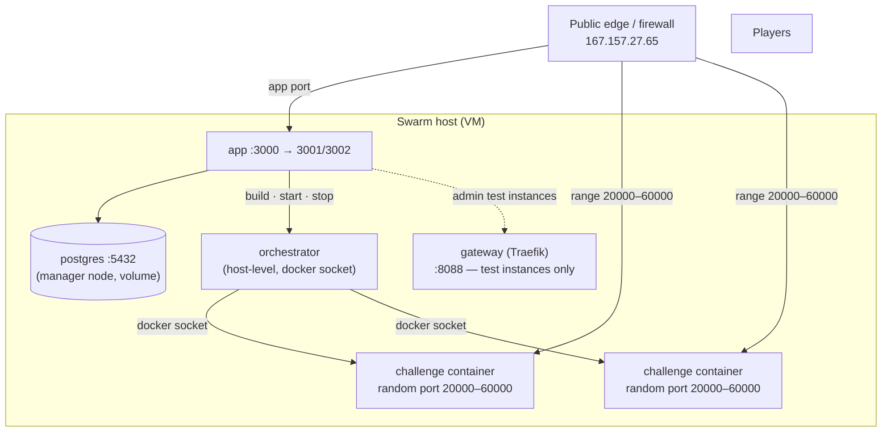

# Deployment guide

How CTFrbt is built, shipped and run — from a `git push` to a live CTF host,
plus the post-deploy steps that make the box effective for an event.

## Environments

| Branch | Stack (Swarm) | App port | DB           | Public URL              |
| ------ | ------------- | -------- | ------------ | ----------------------- |
| `dev`  | `ctfrbt_dev`  | 3001     | `ctfrbt_dev` | `https://ctf.scesi.dev` |
| `main` | `ctfrbt_org`  | 3002     | `ctfrbt_org` | `https://ctf.scesi.org` |

Images land on Docker Hub as `<user>/ctfrbt-app:<tag>` where `<tag>` is
`dev`/`latest` (primary) plus a short-SHA tag for rollbacks, and a registry
build cache keeps builds fast.

## Pipeline



Deploy is fully automatic: `compose.swarm.yml` is copied to
`/opt/ctfrbt/{dev,prod}/`, the image is pulled, and
`docker stack deploy --with-registry-auth` rolls it out. Updates are
**start-first** (zero-downtime), rollbacks are stop-first, and
`docker image prune -af` cleans the host afterwards.

## Server layout



The stack runs **app**, **postgres** (pinned to a manager node, persistent
volume) and the **gateway** (kept for admin test instances). Challenge
containers are created **outside** the stack by the orchestrator, which
must run on the host with access to the Docker socket — see below.

## The orchestrator (manual step)

The orchestrator is **not part of the Swarm stack** (it needs the host
socket). Run it as a standalone container next to the stack, mirroring the
dev compose:

```bash
docker run -d --name ctfrbt-orchestrator \
  --network ctfrbt_org_ctfrbt-network \
  --restart unless-stopped \
  -e ORCHESTRATOR_SECRET="<same secret as the app>" \
  -e DOCKER_SOCKET_PATH=/var/run/docker.sock \
  -v /var/run/docker.sock:/var/run/docker.sock \
  <user>/ctfrbt-app:<tag>   # orchestrator-runner stage
```

Then point the app at it: `ORCHESTRATOR_URL` (defaults to
`http://localhost:7474` — use the container's address on the stack network
for a standalone orchestrator) and the shared `ORCHESTRATOR_SECRET`.
Verify with `GET /healthz` on the orchestrator and the admin's
_Start test instance_ button.

## Environment variables

Everything the app needs (see `.env.example`):

| Variable                                                             | Notes                                                                                                          |
| -------------------------------------------------------------------- | -------------------------------------------------------------------------------------------------------------- |
| `DATABASE_URL`                                                       | built by the deploy job from the per-env DB credentials                                                        |
| `NEXTAUTH_SECRET` / `NEXTAUTH_URL`                                   | per-env; URL is the public HTTPS origin                                                                        |
| `ORCHESTRATOR_SECRET`                                                | shared app ↔ orchestrator secret                                                                               |
| `DOCKER_SOCKET_PATH`                                                 | `/var/run/docker.sock` (Docker) or the rootless podman socket                                                  |
| `GATEWAY_HOST`                                                       | **the host players reach** — LAN IP in dev, public IP in prod (with the 20000–60000 range forwarded to the VM) |
| `SESSION_MAX_AGE_HOURS`                                              | set to at least the event duration                                                                             |
| `RATE_LIMIT_IP_MAX` / `RATE_LIMIT_AUTH_MAX` / `LOGIN_LOCKOUT_IP_MAX` | raise for venues where many players share one public IP (campus NAT, carrier CGNAT)                            |
| `NEXT_PUBLIC_RECAPTCHA_SITE_KEY` / `RECAPTCHA_SECRET_KEY`            | per-env keys, baked in at build time                                                                           |

## Post-deploy checklist

1. **Migrations** run automatically on container start
   (`prisma migrate deploy` in the app CMD) — nothing to do.
2. **Seed** (idempotent; run from a machine that has the source, never from
   the container — the runner image ships no `src/`):

   ```bash
   DATABASE_URL="postgresql://<user>:<pass>@<db-host>:5432/<db>" pnpm db:seed
   ```

   Creates `admin/admin123` plus the dev teams — change the admin password
   before the event.

3. **Edge forwarding**: open the app port **and** the **20000–60000** range
   on the public edge toward the VM. Players' instances are unreachable
   without the range.
4. **Game window**: set start/end in **Admin → Game Configuration**.
   Players cannot start instances after the CTF has ended (the sweep keeps
   the host clean).
5. **Dynamic challenges**: author per
   [dynamic-challenges.md](./dynamic-challenges.md), then verify with
   _Start test instance_.
6. **Smoke test**: register a test team, start an instance, connect
   `http://<GATEWAY_HOST>:<port>`, submit its flag.

## Operating the host during an event

- **Fleet tab** (admin): live table of every instance (state, address,
  expiry, restarts) with a kill button — use it to free resources.
- **Sweeper**: expired instances are stopped and deleted automatically
  (throttled sweep piggybacked on reads); no cron needed.
- **Rate limiting** is in-memory per app instance — fine for a single
  replica; the stack runs one.
- **Rollback**: re-deploy the short-SHA tag from Docker Hub
  (`IMAGE_TAG=<sha> docker stack deploy ...`).
