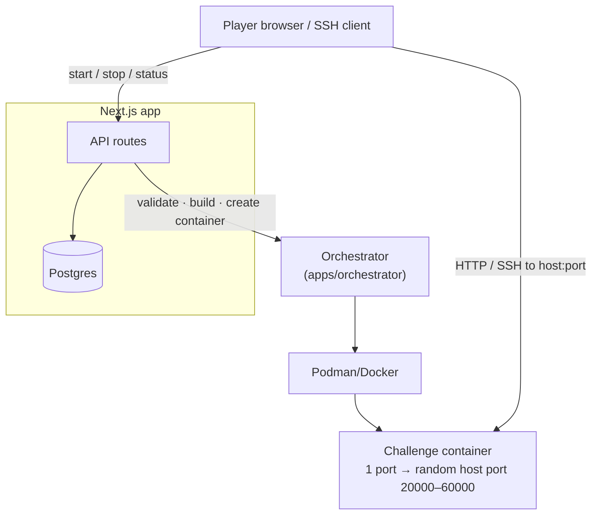
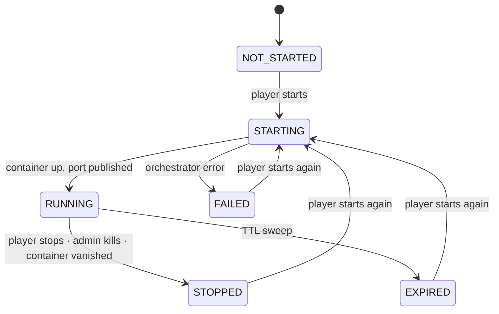
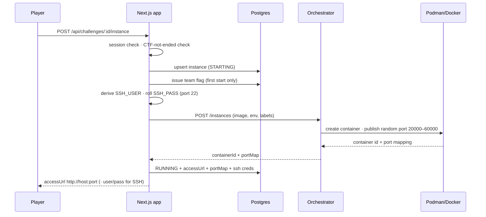

# Dynamic challenges — authoring guide

A **dynamic challenge** ships a Docker image. When a player starts it, the
platform builds (once, at save time) and then runs a **private container per
team**, publishing its single exposed port on a **random host port**
(20000–60000). Each team gets a **unique flag** and, for SSH challenges,
**its own SSH credentials**.

This guide covers the admin workflow: creating the challenge, writing the
Dockerfile, uploading scripts, and using the runtime environment variables
(`FLAG`, `SSH_USER`, `SSH_PASS`) inside `.sh` entrypoints.

## Architecture



- The **app** owns the game state (instances, flags, TTL) in Postgres.
- The **orchestrator** speaks the Podman/Docker Engine API: it builds images and
  creates/stops/deletes containers with an explicit port binding.
- Players reach the container **directly** at `http://<GATEWAY_HOST>:<port>/`
  (or `ssh <user>@<host> -p <port>`) — there is no gateway in the game flow.

## Creating a challenge (admin)

1. **Admin → Challenges → New challenge** and pick mode **dynamic**.
2. Paste the **Dockerfile** and **upload files** (binaries, sources,
   scripts). Files are stored flat; the Dockerfile `COPY`s them by their
   (sanitized) file name.
3. **Save** — the platform validates the Dockerfile and kicks off the build.
   The challenge card shows the build state (`BUILDING` / `READY` /
   `FAILED`) and the build log. The old image stays in place until a
   rebuild finishes, so a failed build never takes the challenge down.
4. Optionally set a **TTL** (minutes). Without a TTL the instance expires at
   game end plus a grace window.
5. Use **Start test instance / Stop test instance** to try the challenge
   from the admin side before the event.

### Dockerfile rules

The validator enforces, at save time:

| Rule                                           | Why                                                                   |
| ---------------------------------------------- | --------------------------------------------------------------------- |
| Must contain `FROM`                            | it is an image definition                                             |
| **Exactly one `EXPOSE <port>` (numeric, TCP)** | one port per instance; it is published on a random host port at start |
| ≤ 64 KB                                        | sanity limit                                                          |

Warnings (non-blocking): base image using `:latest`, container running as
`USER root`.

### Uploaded files

- Max **25 MB** per file, **20 files** per challenge, **100 MB** total.
- Names are flattened and sanitized (no paths, spaces replaced) so the
  Dockerfile can `COPY` them **without quoting**:

  ```dockerfile
  COPY entrypoint.sh /entrypoint.sh
  COPY app /srv/app
  ```

## Runtime environment variables

The platform injects these into **every** instance at start time:

| Variable   | When                | Meaning                                                                                           |
| ---------- | ------------------- | ------------------------------------------------------------------------------------------------- |
| `FLAG`     | always              | the team's **unique flag** — issued once on the first start and stable across restarts            |
| `SSH_USER` | only if `EXPOSE 22` | non-root SSH user derived from the player's alias (lowercase alnum, max 32; `root`/empty → `ctf`) |
| `SSH_PASS` | only if `EXPOSE 22` | random 12-char password — **re-rolled on every start**                                            |

Key point: these are **runtime** variables. They do not exist at build time,
so your `.sh` scripts must read them **at boot** (`$FLAG`), never bake them
into the image (`ARG`/`ENV` in the Dockerfile will not work).

Typical uses in an entrypoint:

- **Web**: write the flag into the served app so it can be found/exploited.
- **SSH**: create the per-team user and plant the flag where only that user
  can read it.

## Example: web challenge

```dockerfile
FROM node:22-alpine
WORKDIR /srv
COPY app /srv/app
COPY entrypoint.sh /entrypoint.sh
RUN chmod +x /entrypoint.sh
EXPOSE 80
ENTRYPOINT ["/entrypoint.sh"]
```

`entrypoint.sh` — plants the team flag inside the app and serves it:

```sh
#!/bin/sh
set -eu

# Plant the team's unique flag where the app can read it.
printf '%s\n' "$FLAG" > /srv/app/secret.txt
chmod 0644 /srv/app/secret.txt

exec /srv/app/start.sh
```

Players see `http://<host>:<port>` on the challenge card and attack the app
to retrieve `/secret.txt` (or wherever your flag lives).

## Example: SSH challenge

```dockerfile
FROM alpine:3.20
RUN apk add --no-cache openssh-server \
 && mkdir /var/run/sshd
COPY entrypoint.sh /entrypoint.sh
RUN chmod +x /entrypoint.sh
EXPOSE 22
ENTRYPOINT ["/entrypoint.sh"]
```

`entrypoint.sh` — creates the per-team user, plants the flag, starts sshd:

```sh
#!/bin/sh
set -eu

# 1. Create the team's non-root user from the injected credentials.
adduser -D -G users -h /home/"$SSH_USER" "$SSH_USER" 2>/dev/null || true
echo "$SSH_USER:$SSH_PASS" | chpasswd

# 2. Plant the team flag, readable only by that user.
install -d -m 0700 -o "$SSH_USER" -g users /secret
printf '%s\n' "$FLAG" > /secret/flag.txt
chmod 0400 /secret/flag.txt

# 3. Fresh host keys every boot (the password already rotates per start).
rm -f /etc/ssh/ssh_host_*
ssh-keygen -A

# 4. Run sshd in the foreground.
exec /usr/sbin/sshd -D
```

Players see `ip:port` **plus** `user / pass` on the challenge card (the
credentials line is only shown when the exposed port is 22) and connect:

```sh
ssh <user>@<host> -p <port>
# then: cat /secret/flag.txt
```

The connection instructions themselves (what the flag is, where to look)
belong in the **challenge description** — the card only shows the address
and, for SSH, the credentials.

## Instance lifecycle

One instance per **(challenge, team)**. Starting a new one (re)creates the
container, re-rolls the published port and the SSH password, and recomputes
the expiry. The flag persists.



- **TTL**: per-challenge `ttlMinutes`, or game end + grace when unset. A
  background sweep (throttled, piggybacked on reads) expires overdue
  instances and deletes their containers.
- **Security rotation**: the published port doubles as the token — a leaked
  URL stops working on the next start. The SSH password rotates the same
  way.
- **Admin control**: the **Fleet** tab lists every instance (with live
  container state) and can kill any of them; test instances are managed
  from the challenge card.
- **Game window**: once the CTF has ended, players can no longer **start**
  instances (403) — running ones can still be stopped, and the sweep keeps
  the host clean.

### Start sequence



## Checklist before the event

- [ ] Build is `READY` and the **test instance** works end to end.
- [ ] The flag is reachable/exploitable exactly as intended.
- [ ] For SSH: connect with the test credentials; the flag file has the
      right owner and permissions.
- [ ] TTL is set (or you accept game-end + grace expiry).
- [ ] `GATEWAY_HOST` in the app env points at the host players can reach
      (LAN IP in dev; the public IP in production, with the 20000–60000
      range forwarded).
